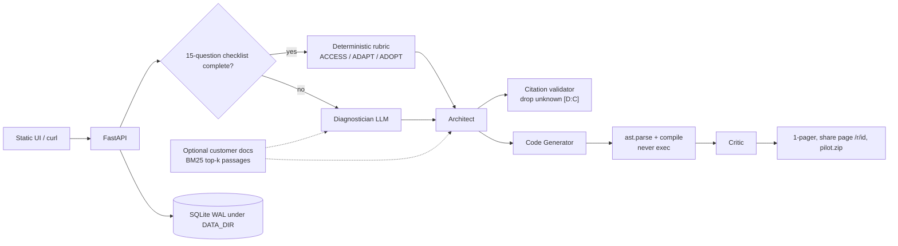

# ResonanceForge

[](https://github.com/sai0610-red/ResonanceForge1/actions/workflows/ci.yml)
[](LICENSE)

Assess whether a team is ready to put agents on **one** workflow, then produce a leadership 1-pager and a starter LangGraph scaffold.

> Demo. Generated code is a scaffold. Not a production certification.

A 30-second walkthrough belongs at [`docs/screenshots/demo.gif`](docs/screenshots/README.md). Until one is added, run the [Red River Components](docs/demo-case.md) case locally (~30–40 seconds after startup).

You describe a situation and answer a fixed 15-question checklist across three **readiness dimensions**: ACCESS (data, APIs, integrations), ADAPT (strategy, sponsorship, budget), and ADOPT (security, observability, human review, evals, ownership). Four agents then run in order: Diagnostician, Architect, Code Generator, Critic.

Optionally, upload the customer's own documents (SOPs, system notes; `.txt`, `.md`, `.pdf`). The Architect gets the most relevant passages, cites them as `[D1:C2]`, and the report adds an **Evidence** section. Citations that do not match a retrieved passage are removed. See [docs/rag.md](docs/rag.md).

## Quick start

```bash
cp .env.example .env          # set GROQ_API_KEY, and optionally DEMO_TOKEN
python3 -m venv .venv && source .venv/bin/activate
pip install -r requirements.txt
make dev                      # http://127.0.0.1:8000
```

Paste the demo token in the UI if you set one. To rerun the fictional demo case:

```bash
curl -N -X POST http://127.0.0.1:8000/api/assessments/stream \
  -H "Content-Type: application/json" \
  -H "X-Demo-Token: $DEMO_TOKEN" \
  --data @docs/red-river-intake.json
```

Docker: `make docker` (mounts `./data:/app/data`). Tests: `make test`. Lint: `make lint`.

## Examples

The fictional [Red River Components](docs/demo-case.md) case is the primary demo. [`docs/examples/`](docs/examples/README.md) adds three outside-in runs on real Dallas–Fort Worth manufacturers (Ennis, Parker Food Group, Optex Systems). They are built only from public information, with assumed checklist answers, and are not affiliated with or reviewed by those companies.

## Architecture



| Stage | What it does |
|-------|----------------|
| Diagnostician | Scores ACCESS / ADAPT / ADOPT (1–10), names gaps, overall Low / Medium / High. Skips the LLM when all 15 answers are present (`app/rubric/checklist.py`). |
| Architect | Agent roles, a high-level flow, estimated complexity. With documents attached, grounded in retrieved passages and cited `[D1:C2]`. |
| Code Generator | A LangGraph Python scaffold (`StateGraph`, `.compile()`). |
| Critic | Risks, recommendations, a go / no-go verdict: Ready for pilot, Needs work, or Not ready. |

The LangGraph path is `app/graphs/resonance_graph.py`. The SSE endpoint (`POST /api/assessments/stream`) runs the same four agents, in the same order, and passes the checklist gap summary into the later agents. LLM: Groq, default `openai/gpt-oss-120b`. Calls have a timeout and retry with exponential backoff.

Outputs: a leadership 1-pager, a share page at `/r/{id}`, a `scaffold_check` PASS/FAIL badge (`ast.parse` + `compile`, **never executed**), and `GET /api/assessments/{id}/pilot.zip` (Dockerfile, smoke tests, `WHAT_BREAKS_FIRST.md`).

## Configuration

Copy `.env.example` to `.env`. Never commit `.env`.

| Variable | Default | Purpose |
|----------|---------|---------|
| `GROQ_API_KEY` | *(empty)* | Groq API key. Required in production. |
| `GROQ_MODEL` | `openai/gpt-oss-120b` | Model id |
| `TEMPERATURE` | `0.2` | LLM temperature |
| `DEMO_TOKEN` | *(empty)* | Enables the token gate when set. Required in production. |
| `RATE_LIMIT_PER_HOUR` | `5` | Assessments per client IP per hour |
| `MAX_SITUATION_CHARS` | `4000` | Max situation length (422 if over) |
| `DATA_DIR` | `./data` | SQLite DB + `pilots/` |
| `LOG_LEVEL` | `INFO` | Log level |
| `LOG_FORMAT` | `json` | `json` or `text` |
| `ENV` | `development` | `production` refuses to start without `GROQ_API_KEY` and `DEMO_TOKEN` |
| `TRUSTED_PROXY` | `false` | When `true`, rate limiting uses the first `X-Forwarded-For` hop. Leave `false` unless you sit behind Fly or Railway. |
| `CORS_ORIGINS` | *(empty)* | Comma-separated origins. Empty = same-origin only. |
| `LLM_TIMEOUT_SECONDS` | `60` | Per-call timeout |
| `LLM_MAX_RETRIES` | `2` | Retries after the first attempt, with backoff |
| `LLM_RETRY_BACKOFF_SECONDS` | `1` | Initial backoff (then 2x, 4x, …) |
| `LLM_RATE_LIMIT_BUDGET_SECONDS` | `90` | Total wait across 429 retries per call; honors Groq's Retry-After / "try again in Xs" |
| `LLM_FALLBACK_MODEL` | *(empty)* | Optional model tried once after rate-limit retries run out (e.g. `openai/gpt-oss-20b`) |
| `CRITIC_MAX_CODE_CHARS` | `8000` | Generated code longer than this is trimmed (head + tail) before the critic reviews it |
| `RAG_MAX_FILES` | `5` | Files per document upload |
| `RAG_MAX_FILE_BYTES` | `2000000` | Max bytes per uploaded file (413 if over) |
| `RAG_MAX_TOTAL_CHARS` | `300000` | Max extracted text per document set |
| `RAG_CHUNK_CHARS` / `RAG_CHUNK_OVERLAP` | `800` / `120` | Chunk size and carry-over for long paragraphs |
| `RAG_TOP_K` | `4` | Passages per agent prompt |
| `UPLOAD_RATE_LIMIT_PER_HOUR` | `20` | Document uploads per client IP per hour |

`GET /health` returns `{"status","env","db_ok","model"}` and an `X-Request-ID` header. No secrets. Logs are JSON lines (`request_id`, `assessment_id`, `agent`, `latency_ms`, `ok`). The demo token and API key are never logged.

## Deploy

This repo is deploy-ready; nothing is deployed automatically.

- [docs/deploy.md](docs/deploy.md) — Fly.io (including one-command `fly deploy`) and Railway
- [fly.toml](fly.toml) — no secrets; set `GROQ_API_KEY` and `DEMO_TOKEN` with `fly secrets set`
- Single instance only: SQLite on a volume plus an in-memory rate limiter
- Image: multi-stage, non-root user, `HEALTHCHECK`

## Security model

- **Demo token.** When `DEMO_TOKEN` is set, these require `X-Demo-Token` (constant-time compare, 401 on miss): `POST /assess`, `POST /api/assessments/stream`, `GET /api/assessments`, `GET /api/assessments/{id}`, `GET /api/assessments/{id}/pilot.zip`, `POST /api/documents`, `GET /api/documents/{id}`. Public: `GET /`, `/health`, `/r/{id}`, `GET /api/checklist`, `GET /api/reports/{id}`, `/static/*`.
- **Rate limit.** Sliding window per client IP on the two assessment POST routes. Over the limit: **429** + `Retry-After`. `TRUSTED_PROXY` defaults to off so clients cannot spoof `X-Forwarded-For`.
- **Input limits.** Empty or over-long `question` returns **422** before any LLM call. Document uploads are capped by count, bytes, and extracted characters (**413**), restricted to txt / md / pdf (**415**), and only extracted text is stored.
- **Headers.** `X-Content-Type-Options`, `X-Frame-Options`, `Referrer-Policy`, `Content-Security-Policy`, plus HSTS in production. Optional CORS via `CORS_ORIGINS`.
- **Share links.** `/r/{id}` is public if you have the UUID. Links do not expire and cannot be revoked. If documents were attached, the share page includes the Evidence passages, so do not attach anything you would not put in the report. See Limitations.
- **Production startup.** Refuses to boot without `GROQ_API_KEY` and `DEMO_TOKEN`.

## Limitations

- **Scaffold, not certification.** The compile badge only proves the generated code parses. It is not tested against your systems and is not a security review.
- **LLM variance.** Architect, Code Generator, and Critic output can change between runs. Only the checklist scores are deterministic.
- **Single-instance SQLite** (WAL mode) on one volume. No horizontal scaling. Back up `DATA_DIR/resonanceforge.db` (and the `-wal` / `-shm` files, or run `PRAGMA wal_checkpoint(TRUNCATE)` first). See [docs/deploy.md](docs/deploy.md).
- **In-memory rate limit** resets on restart. Behind a proxy, leave `TRUSTED_PROXY=false` unless the platform sets `X-Forwarded-For`.
- **Share links are public** and have no expiry or revocation. IDs are random UUID4s.
- **Demo token is a shared secret**, not per-user auth. No SSO, no multi-tenant isolation.
- **Groq free tier is ~8,000 tokens/minute** for `openai/gpt-oss-120b`. One run makes up to three LLM calls in under a minute, so the Critic can hit the limit. The app waits for Groq's reset hint (the UI shows "Waiting on model rate limit") instead of failing, which can add up to a minute to a run. A paid Groq tier removes the wait.
- **Document grounding is lexical (BM25)**, not embeddings, and has no per-tenant isolation or OCR. See [docs/rag.md](docs/rag.md#not-done-yet).
- No human-in-the-loop UI, no billing. Requires a valid Groq API key.

## Tests

```bash
make test          # python -m pytest tests/ -q
make lint          # ruff check app tests
```

- `tests/test_checklist.py` — rubric scoring
- `tests/test_scaffold_check.py` — compile-check (valid, syntax error, fences, empty; never executes)
- `tests/test_demo_gate.py` — 401 / public routes / 422 / 429 / production startup guard
- `tests/test_hardening.py` — request IDs, security headers, trusted-proxy rate limit, LLM retry, stream gap summary, WAL
- `tests/test_llm_rate_limit.py` — Groq 429 handling: retry-after hints, backoff budget, fallback model, SSE wait status, critic code trimming
- `tests/test_rag.py` — chunking, txt/md/pdf extraction, BM25 ranking, citation validation (unknown and out-of-scope refs dropped), upload auth / size / type / rate limits, grounding on both the SSE and sync paths, no-docs behaviour unchanged

The same lint + test commands are what CI should run on every push and pull request. No test makes a live Groq call.

## API summary

| Method | Path | Auth when `DEMO_TOKEN` set | Description |
|--------|------|---------------------------|-------------|
| `GET` | `/` | public | Main UI |
| `GET` | `/static/*` | public | Static assets |
| `GET` | `/health` | public | `{status, env, db_ok, model}` |
| `GET` | `/api/checklist` | public | 15-question checklist |
| `GET` | `/api/reports/{id}` | public | Completed report JSON (share page) |
| `GET` | `/r/{id}` | public | Share page HTML |
| `POST` | `/assess` | token + rate limit | Sync assessment (`X-Assessment-Id`) |
| `POST` | `/api/assessments/stream` | token + rate limit | SSE (`event: step` / `status` / `complete` / `error`) |
| `GET` | `/api/assessments` | token | History list |
| `GET` | `/api/assessments/{id}` | token | Full record |
| `GET` | `/api/assessments/{id}/pilot.zip` | token | Runnable Docker pilot |
| `POST` | `/api/documents` | token + upload limit | Multipart `files` (txt / md / pdf) → `document_set_id` |
| `GET` | `/api/documents/{id}` | token | Labels, filenames, sizes, chunk counts |

## License

MIT © 2026 Sairam Reddy Dornala
