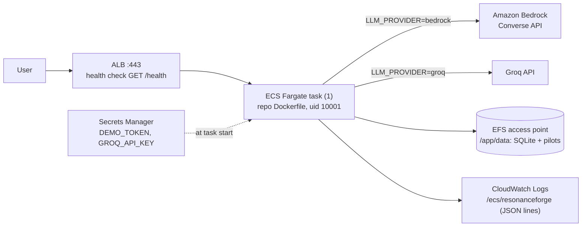

# Deploying on AWS (ECS Fargate + ALB, optional Bedrock)

> **Status: not deployed.** Nothing in this repo has been deployed to AWS, and these
> steps have not been run against a live account. The templates are valid JSON and
> unit-tested for shape (`tests/test_deploy_aws.py`). The Bedrock code path is
> unit-tested with mocks and a real `ChatBedrockConverse` object that never sends a
> request. Expect to fix small things the first time you run this.

The target is one Fargate task behind an Application Load Balancer:



The app pieces this depends on:

- `LLM_PROVIDER=groq|bedrock` (`app/core/llm.py`). Bedrock uses
  `langchain_aws.ChatBedrockConverse`, with `BEDROCK_MODEL_ID` (default
  `openai.gpt-oss-120b-1:0`, the same open-weight model the Groq default runs) and
  `AWS_REGION`. Credentials come from the default AWS chain, which is the task role
  on ECS. No AWS keys are read from settings. SDK retries are off, so
  `invoke_with_retry` handles Bedrock `ThrottlingException` the same way as a Groq
  429 (waits, SSE "waiting on rate limit" events, optional `LLM_FALLBACK_MODEL`).
  `AccessDeniedException` fails fast.
- `requirements-aws.txt` (langchain-aws, boto3) is installed only with
  `docker build --build-arg INSTALL_AWS=true`, so the default image stays small.
- `TRUSTED_PROXY=true` with `TRUSTED_PROXY_HOP=last`. The ALB *appends* the client
  address to `X-Forwarded-For`, so only the right-most entry can be trusted. The
  Fly/Railway setting (`first`) would let a client spoof the rate-limit key.
- `ENV=production` refuses to start without `DEMO_TOKEN`, plus `GROQ_API_KEY` for
  Groq or `BEDROCK_MODEL_ID` / `AWS_REGION` for Bedrock.

## Before you start

- AWS CLI v2 configured for the target account. `docker`, `jq`, and `envsubst`
  (gettext).
- A VPC with two public subnets (for the ALB) and two private subnets with NAT or
  VPC endpoints (for the task: ECR, Secrets Manager, CloudWatch Logs, Bedrock).
- An ACM certificate for your domain, if you want HTTPS on the ALB (you should).
- For Bedrock: check that the model is available in your region and that your
  account can invoke it (Bedrock console → Model access).

```bash
export AWS_REGION=us-west-2
export AWS_ACCOUNT_ID=$(aws sts get-caller-identity --query Account --output text)
export LLM_PROVIDER=bedrock          # or groq
export IMAGE_TAG=$(git rev-parse --short HEAD)
export VPC_ID=vpc-...                # yours
export PUBLIC_SUBNETS="subnet-a subnet-b"
export PRIVATE_SUBNETS="subnet-c subnet-d"
```

## 1. Image (ECR)

The task uses the repo's own `Dockerfile` (multi-stage, non-root, `HEALTHCHECK`).

```bash
aws ecr create-repository --repository-name resonanceforge --image-scanning-configuration scanOnPush=true
aws ecr get-login-password | docker login --username AWS --password-stdin \
  "$AWS_ACCOUNT_ID.dkr.ecr.$AWS_REGION.amazonaws.com"
docker build --build-arg INSTALL_AWS=true --platform linux/amd64 \
  -t "$AWS_ACCOUNT_ID.dkr.ecr.$AWS_REGION.amazonaws.com/resonanceforge:$IMAGE_TAG" .
docker push "$AWS_ACCOUNT_ID.dkr.ecr.$AWS_REGION.amazonaws.com/resonanceforge:$IMAGE_TAG"
```

## 2. Secrets (Secrets Manager)

```bash
export DEMO_TOKEN_SECRET_ARN=$(aws secretsmanager create-secret \
  --name resonanceforge/demo-token \
  --secret-string "$(python3 -c 'import secrets;print(secrets.token_urlsafe(24))')" \
  --query ARN --output text)

# Groq provider only. Paste the key at the prompt so it stays out of shell history.
read -rs GROQ_KEY && export GROQ_SECRET_ARN=$(aws secretsmanager create-secret \
  --name resonanceforge/groq-api-key --secret-string "$GROQ_KEY" --query ARN --output text); unset GROQ_KEY
```

With `LLM_PROVIDER=bedrock` you can skip the Groq secret. Remove it from the task
definition in step 6.

## 3. Logs (CloudWatch)

```bash
aws logs create-log-group --log-group-name /ecs/resonanceforge
aws logs put-retention-policy --log-group-name /ecs/resonanceforge --retention-in-days 30
```

The app already logs JSON lines (`request_id`, `assessment_id`, `agent`,
`latency_ms`, `ok`), so CloudWatch Logs Insights can query them directly:

```
fields @timestamp, agent, latency_ms, ok | filter ispresent(agent) | stats avg(latency_ms), count(*) by agent, ok
```

## 4. Storage (EFS for `/app/data`)

SQLite and pilot zips need a persistent volume. Fargate task storage is ephemeral.

```bash
export EFS_FILE_SYSTEM_ID=$(aws efs create-file-system --encrypted \
  --tags Key=Name,Value=resonanceforge --query FileSystemId --output text)
export EFS_ACCESS_POINT_ID=$(aws efs create-access-point --file-system-id "$EFS_FILE_SYSTEM_ID" \
  --posix-user Uid=10001,Gid=10001 \
  --root-directory 'Path=/resonanceforge,CreationInfo={OwnerUid=10001,OwnerGid=10001,Permissions=750}' \
  --query AccessPointId --output text)

# Security groups: ALB (443 from the internet), task (8000 from the ALB), EFS (2049 from the task).
export ALB_SG=$(aws ec2 create-security-group --group-name rf-alb --description "rf alb" --vpc-id "$VPC_ID" --query GroupId --output text)
export TASK_SG=$(aws ec2 create-security-group --group-name rf-task --description "rf task" --vpc-id "$VPC_ID" --query GroupId --output text)
export EFS_SG=$(aws ec2 create-security-group --group-name rf-efs --description "rf efs" --vpc-id "$VPC_ID" --query GroupId --output text)
aws ec2 authorize-security-group-ingress --group-id "$ALB_SG" --protocol tcp --port 443 --cidr 0.0.0.0/0
aws ec2 authorize-security-group-ingress --group-id "$TASK_SG" --protocol tcp --port 8000 --source-group "$ALB_SG"
aws ec2 authorize-security-group-ingress --group-id "$EFS_SG" --protocol tcp --port 2049 --source-group "$TASK_SG"
for s in $PRIVATE_SUBNETS; do
  aws efs create-mount-target --file-system-id "$EFS_FILE_SYSTEM_ID" --subnet-id "$s" --security-groups "$EFS_SG"
done
```

The entrypoint's `chown` of `DATA_DIR` is a no-op on the access point, because
files are already owned by uid 10001, and failures there are ignored.

## 5. IAM roles

```bash
aws iam create-role --role-name resonanceforge-execution \
  --assume-role-policy-document file://deploy/aws/iam/ecs-tasks-trust-policy.json
aws iam attach-role-policy --role-name resonanceforge-execution \
  --policy-arn arn:aws:iam::aws:policy/service-role/AmazonECSTaskExecutionRolePolicy
envsubst < deploy/aws/iam/execution-role-secrets-policy.json > /tmp/rf-exec-secrets.json
aws iam put-role-policy --role-name resonanceforge-execution \
  --policy-name read-app-secrets --policy-document file:///tmp/rf-exec-secrets.json

aws iam create-role --role-name resonanceforge-task \
  --assume-role-policy-document file://deploy/aws/iam/ecs-tasks-trust-policy.json
envsubst < deploy/aws/iam/task-role-policy.json > /tmp/rf-task.json
aws iam put-role-policy --role-name resonanceforge-task \
  --policy-name bedrock-and-efs --policy-document file:///tmp/rf-task.json
```

The execution role pulls the image, writes logs, and reads the two secrets at
start. The task role is what the app runs as: `bedrock:InvokeModel` on the one
configured model, plus EFS mount through the access point. If you change
`BEDROCK_MODEL_ID`, change the resource in `task-role-policy.json` too. If you skipped
the Groq secret, delete it from `execution-role-secrets-policy.json` before
rendering.

## 6. Task definition

```bash
envsubst < deploy/aws/task-definition.json > /tmp/rf-taskdef.json
# Bedrock only: drop the Groq secret.
[ "$LLM_PROVIDER" = bedrock ] && jq '(.containerDefinitions[0].secrets) |= map(select(.name != "GROQ_API_KEY"))' \
  /tmp/rf-taskdef.json > /tmp/rf-taskdef.b.json && mv /tmp/rf-taskdef.b.json /tmp/rf-taskdef.json
aws ecs register-task-definition --cli-input-json file:///tmp/rf-taskdef.json
```

What is in it: 0.5 vCPU / 1 GB, `awsvpc`, port 8000, `ENV=production`, the
container health check on `http://127.0.0.1:8000/health` (same as the Dockerfile's
`HEALTHCHECK`), the `awslogs` driver to `/ecs/resonanceforge`, secrets injected as
`DEMO_TOKEN` / `GROQ_API_KEY` env vars (never in plain `environment`), and the EFS
volume at `/app/data`.

## 7. Load balancer (health check on `/health`)

```bash
export ALB_ARN=$(aws elbv2 create-load-balancer --name resonanceforge --type application \
  --subnets $PUBLIC_SUBNETS --security-groups "$ALB_SG" --query 'LoadBalancers[0].LoadBalancerArn' --output text)
# SSE streams can sit quiet between keepalives (15 s). Keep the idle timeout well above that.
aws elbv2 modify-load-balancer-attributes --load-balancer-arn "$ALB_ARN" \
  --attributes Key=idle_timeout.timeout_seconds,Value=300
export TG_ARN=$(aws elbv2 create-target-group --name resonanceforge --protocol HTTP --port 8000 \
  --vpc-id "$VPC_ID" --target-type ip \
  --health-check-path /health --health-check-interval-seconds 30 \
  --healthy-threshold-count 2 --unhealthy-threshold-count 3 --matcher HttpCode=200 \
  --query 'TargetGroups[0].TargetGroupArn' --output text)
aws elbv2 create-listener --load-balancer-arn "$ALB_ARN" --protocol HTTPS --port 443 \
  --certificates CertificateArn=arn:aws:acm:...your-cert... \
  --default-actions Type=forward,TargetGroupArn="$TG_ARN"
```

`/health` is public and returns `{"status","env","db_ok","provider","model"}`, with
no secrets.

## 8. Cluster and service (exactly one task)

```bash
aws ecs create-cluster --cluster-name resonanceforge
aws ecs create-service --cluster resonanceforge --service-name resonanceforge \
  --task-definition resonanceforge --desired-count 1 --launch-type FARGATE \
  --deployment-configuration "maximumPercent=100,minimumHealthyPercent=0" \
  --network-configuration "awsvpcConfiguration={subnets=[${PRIVATE_SUBNETS// /,}],securityGroups=[$TASK_SG],assignPublicIp=DISABLED}" \
  --load-balancers "targetGroupArn=$TG_ARN,containerName=app,containerPort=8000" \
  --health-check-grace-period-seconds 30
```

`maximumPercent=100` / `minimumHealthyPercent=0` stops the old and new task from
writing the same SQLite file during a deploy. You get a short outage instead.
That is the honest trade-off of SQLite. See "Next steps".

## 9. Verify

```bash
DNS=$(aws elbv2 describe-load-balancers --load-balancer-arns "$ALB_ARN" --query 'LoadBalancers[0].DNSName' --output text)
curl -s "https://$DNS/health"         # expect "provider":"bedrock" (or "groq")
aws logs tail /ecs/resonanceforge --follow
```

Then open the UI, paste the demo token (read it with
`aws secretsmanager get-secret-value --secret-id resonanceforge/demo-token`), and
run the Red River case.

## Teardown

```bash
aws ecs update-service --cluster resonanceforge --service resonanceforge --desired-count 0
aws ecs delete-service --cluster resonanceforge --service resonanceforge --force
aws ecs delete-cluster --cluster resonanceforge
aws elbv2 delete-load-balancer --load-balancer-arn "$ALB_ARN"
aws elbv2 delete-target-group --target-group-arn "$TG_ARN"   # after the ALB is gone
# Then EFS mount targets, access point, and file system; the security groups;
# both IAM roles; both secrets (--force-delete-without-recovery); the log group; and the ECR repo.
```

## Cost notes

There are no measured numbers here because nothing has been deployed. The
always-on pieces are the ALB, one Fargate task, NAT (if you use it), and EFS
storage. Bedrock is billed per token on the configured model. Check current
pricing for your region before you leave it running.

## Next steps (not done)

- **RDS Postgres instead of SQLite.** `app/db.py` talks to `sqlite3` directly, and
  there is no `DATABASE_URL` yet. Moving to RDS means a small repository layer (or
  SQLAlchemy) over the same four tables, a migration, and then `desired-count > 1`
  becomes possible. Until then, run exactly one task.
- **Shared rate limiting.** The limiter is in-memory per task. With more than one
  task it needs ElastiCache or DynamoDB, or AWS WAF rate-based rules on the ALB.
- **Per-user auth.** `DEMO_TOKEN` is a shared secret. Cognito or an OIDC ALB
  listener rule would replace it.
- **Embeddings for retrieval.** BM25 could be swapped for Bedrock Titan embeddings
  with pgvector on the same RDS instance (see `docs/rag.md`).
- **Infrastructure as code.** These are CLI steps. CDK or Terraform is the next step.
