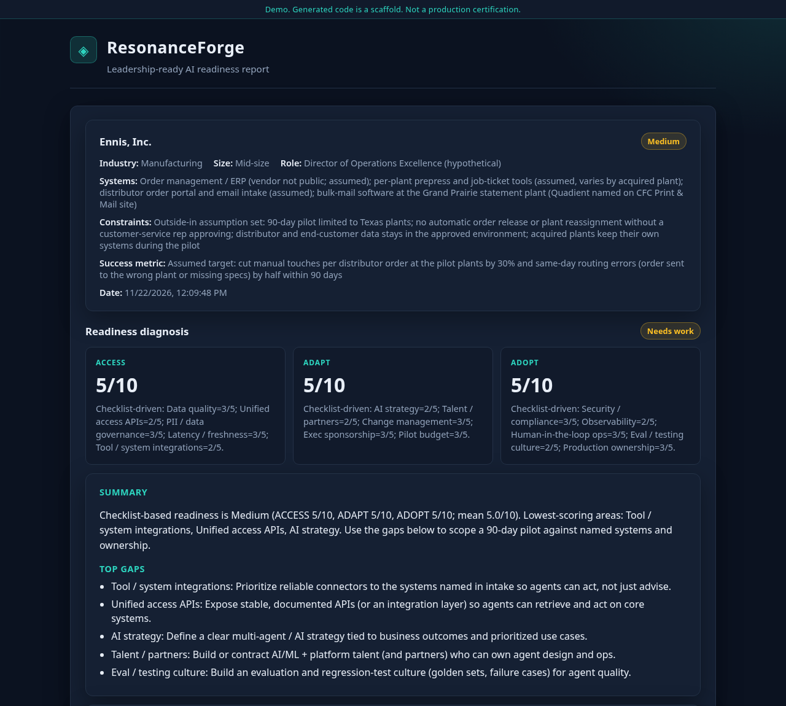
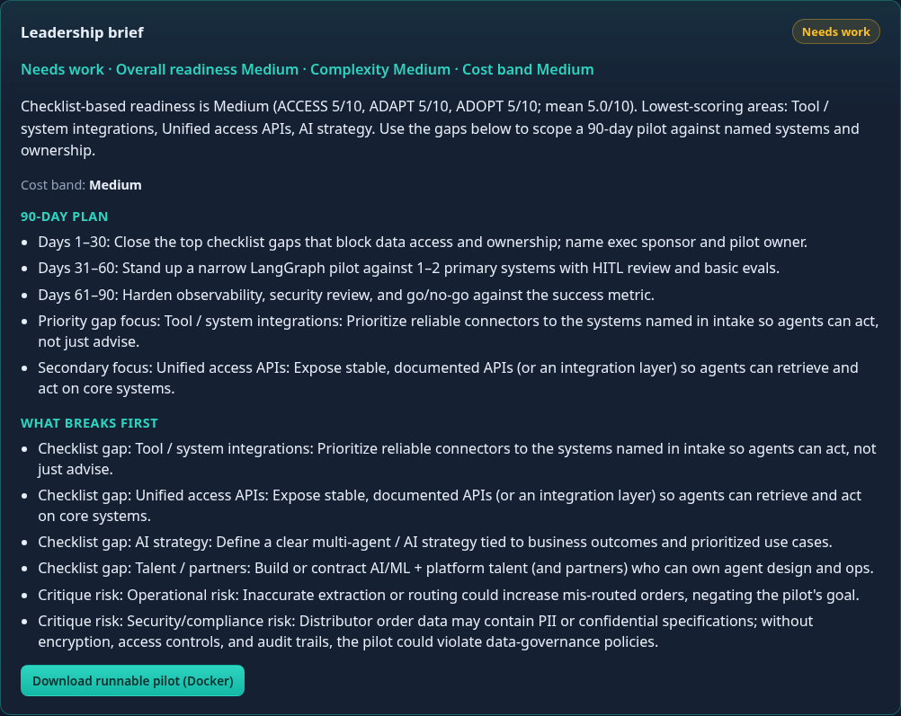

# Ennis, Inc. — outside-in readiness example

> **Outside-in illustration built only from public information (sources below). Not affiliated with, endorsed by, or reviewed by Ennis, Inc.. Systems and checklist answers are assumptions, not facts about the company's internal operations. Generated by an LLM pipeline; not a professional assessment.**

Workflow assessed: **Distributor order intake and plant routing (DFW-area plants)**. The workflow was picked by the author to fit the company's public footprint. The company did not choose or confirm it.

## Company summary

Ennis, Inc. (NYSE: EBF) is a trade printer headquartered in Midlothian, Texas, in the Dallas–Fort Worth area. Its FY2026 Form 10-K describes business forms, pressure-seal forms, labels, tags, envelopes and presentation folders sold through independent distributors; FY2026 revenue of about $392M; 1,835 employees; and roughly 50 manufacturing plants in 20 states. Texas plants listed in the 10-K include Ennis, Arlington and Grand Prairie (statement printing and mailing) and Wolfe City. In November 2025 Ennis acquired CFC Print & Mail in Grand Prairie [1][2][3][4].

## Intake summary

- **Role:** Director of Operations Excellence (hypothetical)
- **Primary systems:** Order management / ERP (vendor not public; assumed); per-plant prepress and job-ticket tools (assumed, varies by acquired plant); distributor order portal and email intake (assumed); bulk-mail software at the Grand Prairie statement plant (Quadient named on CFC Print & Mail site)
- **Constraints:** Outside-in assumption set: 90-day pilot limited to Texas plants; no automatic order release or plant reassignment without a customer-service rep approving; distributor and end-customer data stays in the approved environment; acquired plants keep their own systems during the pilot
- **Success metric:** Assumed target: cut manual touches per distributor order at the pilot plants by 30% and same-day routing errors (order sent to the wrong plant or missing specs) by half within 90 days
- **Full intake:** [`intake.json`](intake.json) (situation text marks what is sourced and what is assumed)

**Checklist answers (assumptions, 1–5).** These were set conservatively and neutrally because none of this is public. A real assessment would replace every value with answers from the company.

| Question | Assumed answer |
|---|---:|
| Data quality | 3/5 |
| Unified access APIs | 2/5 |
| PII / data governance | 3/5 |
| Latency / freshness | 3/5 |
| Tool / system integrations | 2/5 |
| AI strategy | 2/5 |
| Talent / partners | 2/5 |
| Change management | 3/5 |
| Exec sponsorship | 3/5 |
| Pilot budget | 3/5 |
| Security / compliance | 3/5 |
| Observability | 2/5 |
| Human-in-the-loop ops | 3/5 |
| Eval / testing culture | 2/5 |
| Production ownership | 3/5 |

## Scores across the readiness dimensions

| Readiness dimension | Score | Driver |
|---|---:|---|
| ACCESS | 5/10 | Checklist-driven: Data quality=3/5; Unified access APIs=2/5; PII / data governance=3/5; Latency / freshness=3/5; Tool / system integrations=2/5. |
| ADAPT | 5/10 | Checklist-driven: AI strategy=2/5; Talent / partners=2/5; Change management=3/5; Exec sponsorship=3/5; Pilot budget=3/5. |
| ADOPT | 5/10 | Checklist-driven: Security / compliance=3/5; Observability=2/5; Human-in-the-loop ops=3/5; Eval / testing culture=2/5; Production ownership=3/5. |
| **Overall** | **Medium** | Deterministic checklist rubric (not model-scored) |



## Verdict and top recommendations

Critic verdict: **Needs work**. The 1-pager's go/no-go is **Needs work**. Estimated complexity: **Medium**. Cost band: **Medium**.

Top recommendations, quoted from the run:

> - Develop concrete integration adapters for the ERP/order‑management system and each plant's pre‑press/job‑ticket tool (including Quadient), with retry and idempotency handling.
> - Implement a robust LLM extraction pipeline: use OCR for PDFs, email parsers, and prompt engineering; include confidence scores and fallback manual review for low‑confidence cases.
> - Design a secure data handling layer: encrypt data at rest and in transit, enforce role‑based access, and log PII handling for compliance.
> - Expand routing logic to consume real‑time plant capacity data from a central capacity service; make rules configurable rather than hard‑coded.
> - Create a testing harness with golden order sets, automated regression tests, and monitoring of extraction accuracy and routing correctness.

Risks the critic flagged, quoted:

> - Operational risk: Inaccurate extraction or routing could increase mis‑routed orders, negating the pilot's goal.
> - Security/compliance risk: Distributor order data may contain PII or confidential specifications; without encryption, access controls, and audit trails, the pilot could violate data‑governance policies.
> - Integration risk: Assuming connectors exist without building them may cause delays; plant systems are heterogeneous and may not expose APIs.
> - Change‑management risk: Customer‑service reps may resist a new UI if it adds steps without clear benefit; lack of training plan noted.
> - Model hallucination risk: LLM‑driven extraction may hallucinate fields, leading to incorrect job tickets.
> - Scalability risk: Hard‑coded routing logic will not scale beyond the pilot plants; future expansion would require re‑engineering.

Proposed agents: Order Ingestion Agent, Extraction & Validation Agent, Routing Recommendation Agent, Clarification Draft Agent, Human‑in‑the‑Loop Review UI (operated by Customer‑Service Rep), Observability & Audit Agent.

## 90-day plan (from the 1-pager)

- Days 1–30: Close the top checklist gaps that block data access and ownership; name exec sponsor and pilot owner.
- Days 31–60: Stand up a narrow LangGraph pilot against 1–2 primary systems with HITL review and basic evals.
- Days 61–90: Harden observability, security review, and go/no-go against the success metric.
- Priority gap focus: Tool / system integrations: Prioritize reliable connectors to the systems named in intake so agents can act, not just advise.
- Secondary focus: Unified access APIs: Expose stable, documented APIs (or an integration layer) so agents can retrieve and act on core systems.

## What breaks first (from the pilot package)

- Checklist gap: Tool / system integrations: Prioritize reliable connectors to the systems named in intake so agents can act, not just advise.
- Checklist gap: Unified access APIs: Expose stable, documented APIs (or an integration layer) so agents can retrieve and act on core systems.
- Checklist gap: AI strategy: Define a clear multi-agent / AI strategy tied to business outcomes and prioritized use cases.
- Checklist gap: Talent / partners: Build or contract AI/ML + platform talent (and partners) who can own agent design and ops.
- Critique risk: Operational risk: Inaccurate extraction or routing could increase mis‑routed orders, negating the pilot's goal.
- Critique risk: Security/compliance risk: Distributor order data may contain PII or confidential specifications; without encryption, access controls, and audit trails, the pilot could violate data‑governance policies.
- Critique risk: Integration risk: Assuming connectors exist without building them may cause delays; plant systems are heterogeneous and may not expose APIs.
- Weakness: Code assumes all integrations are simple function calls; no concrete connectors to ERP, plant‑specific job‑ticket tools, or Quadient bulk‑mail system are defined.



## Compile check

Generated LangGraph scaffold: **PASS**. It has 96 lines, `StateGraph` present: True, `.compile()` present: True. This is a static parse and compile check. The code was not executed, and passing means it parses, not that it works.

## Run details

- Assessment id: `56502b7b-2397-4520-a2ee-6b20af9db3e4` (local run, 2026-11-22; share links point to a local instance and are not public)
- Model: `openai/gpt-oss-120b` via Groq, temperature 0.2
- Agent latency (ms): diagnostician 0 (rubric only, no model call), architect 2541, code generator 3654, critic 22147 (includes waiting out the provider rate limit)
- LLM output varies between runs. Scores come from the checklist rubric and are reproducible. Verdict, recommendations and code wording may differ.

## How to reproduce

```bash
curl -N -X POST http://127.0.0.1:8000/api/assessments/stream \
  -H "Content-Type: application/json" \
  -H "X-Demo-Token: $DEMO_TOKEN" \
  --data @docs/examples/ennis/intake.json
```

## Sources

1. https://www.sec.gov/Archives/edgar/data/33002/000119312526213764/ebf-20260228.htm — Form 10-K, fiscal year ended Feb 28, 2026 (HQ, revenue context, employees, plant list, CFC acquisition, backlog)
2. https://www.ennis.com/documents/2026/04/ennis-inc-reports-results-for-the-quarter-and-year-ended-february-28-2026.pdf/ — FY2026 results release ($392.4M revenue)
3. https://www.ennis.com/our-history/ — company history (founded 1909 in Ennis, TX)
4. https://cfcprint.com/ and https://cfcprint.com/transactional-print-and-mailing — CFC Print & Mail (Grand Prairie) services; names Quadient bulk-mail software
