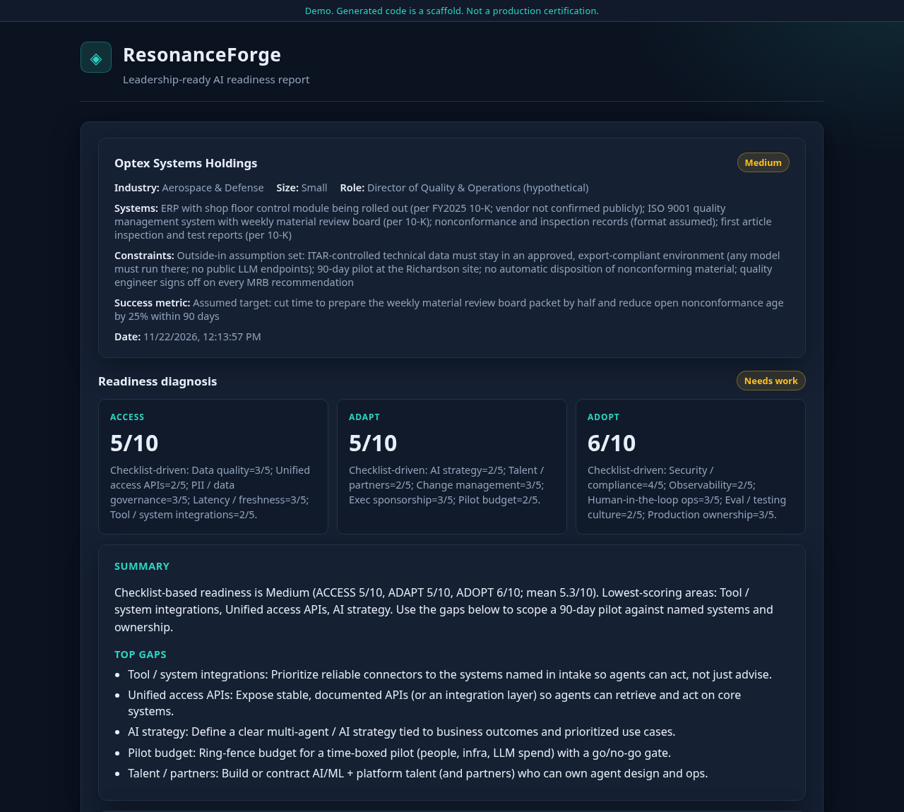
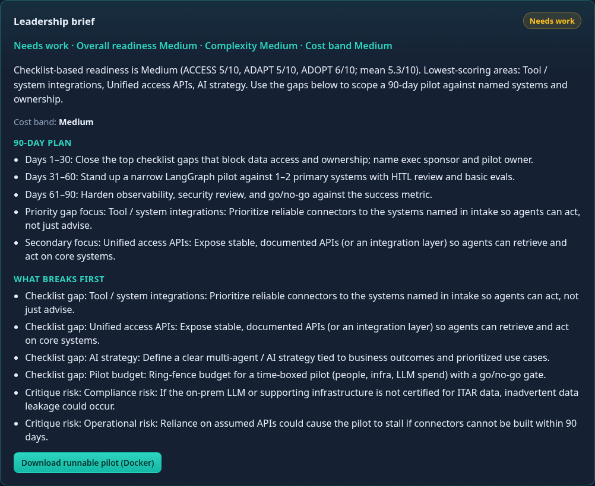

# Optex Systems Holdings — outside-in readiness example

> **Outside-in illustration built only from public information (sources below). Not affiliated with, endorsed by, or reviewed by Optex Systems Holdings. Systems and checklist answers are assumptions, not facts about the company's internal operations. Generated by an LLM pipeline; not a professional assessment.**

Workflow assessed: **Nonconformance triage and weekly material review board (MRB) preparation**. The workflow was picked by the author to fit the company's public footprint. The company did not choose or confirm it.

## Company summary

Optex Systems Holdings (NASDAQ: OPXS) is based in Richardson, Texas, in the Dallas–Fort Worth area. It designs and builds optical sighting systems for defense customers: vehicle periscopes, rifle and surveillance sights, and night vision optical assemblies. Its Applied Optics Center in Dallas does optical coatings. Its FY2025 Form 10-K reports revenue of about $41.3M, a 49,100 sq ft Richardson facility with 87 FTEs on a single shift, an ISO 9001 quality system, a weekly material review board, and an ERP shop-floor-control module still being rolled out [1][2][3].

## Intake summary

- **Role:** Director of Quality & Operations (hypothetical)
- **Primary systems:** ERP with shop floor control module being rolled out (per FY2025 10-K; vendor not confirmed publicly); ISO 9001 quality management system with weekly material review board (per 10-K); nonconformance and inspection records (format assumed); first article inspection and test reports (per 10-K)
- **Constraints:** Outside-in assumption set: ITAR-controlled technical data must stay in an approved, export-compliant environment (any model must run there; no public LLM endpoints); 90-day pilot at the Richardson site; no automatic disposition of nonconforming material; quality engineer signs off on every MRB recommendation
- **Success metric:** Assumed target: cut time to prepare the weekly material review board packet by half and reduce open nonconformance age by 25% within 90 days
- **Full intake:** [`intake.json`](intake.json) (situation text marks what is sourced and what is assumed)

**Checklist answers (assumptions, 1–5).** These were set conservatively and neutrally because none of this is public. A real assessment would replace every value with answers from the company.

| Question | Assumed answer |
|---|---:|
| Data quality | 3/5 |
| Unified access APIs | 2/5 |
| PII / data governance | 3/5 |
| Latency / freshness | 3/5 |
| Tool / system integrations | 2/5 |
| AI strategy | 2/5 |
| Talent / partners | 2/5 |
| Change management | 3/5 |
| Exec sponsorship | 3/5 |
| Pilot budget | 2/5 |
| Security / compliance | 4/5 |
| Observability | 2/5 |
| Human-in-the-loop ops | 3/5 |
| Eval / testing culture | 2/5 |
| Production ownership | 3/5 |

## Scores across the readiness dimensions

| Readiness dimension | Score | Driver |
|---|---:|---|
| ACCESS | 5/10 | Checklist-driven: Data quality=3/5; Unified access APIs=2/5; PII / data governance=3/5; Latency / freshness=3/5; Tool / system integrations=2/5. |
| ADAPT | 5/10 | Checklist-driven: AI strategy=2/5; Talent / partners=2/5; Change management=3/5; Exec sponsorship=3/5; Pilot budget=2/5. |
| ADOPT | 6/10 | Checklist-driven: Security / compliance=4/5; Observability=2/5; Human-in-the-loop ops=3/5; Eval / testing culture=2/5; Production ownership=3/5. |
| **Overall** | **Medium** | Deterministic checklist rubric (not model-scored) |



## Verdict and top recommendations

Critic verdict: **Needs work**. The 1-pager's go/no-go is **Needs work**. Estimated complexity: **Medium**. Cost band: **Medium**.

Top recommendations, quoted from the run:

> - Conduct a detailed integration assessment: inventory ERP/QMS data sources, confirm API availability, and design a thin integration layer (e.g., REST or gRPC) with authentication, pagination, and error handling.
> - Define a concrete data schema for MRB state (e.g., typed objects for NC records, parts, suppliers, inspection results) and implement validation logic to ensure completeness before LLM invocation.
> - Select and harden an on‑prem LLM platform that is ITAR‑certified; develop a prompt library, fine‑tune on historical MRB decisions, and establish a validation pipeline (rule‑based checks + human review) before any disposition is persisted.
> - Implement robust security controls: encrypt data in transit and at rest, enforce role‑based access, maintain immutable audit logs, and perform a compliance review with the legal/exports team.
> - Expand observability: capture latency per step, LLM token usage, API error rates, and KPI metrics (time‑to‑prepare, NC age). Integrate with existing monitoring tools (e.g., Prometheus, Splunk).

Risks the critic flagged, quoted:

> - Compliance risk: If the on‑prem LLM or supporting infrastructure is not certified for ITAR data, inadvertent data leakage could occur.
> - Operational risk: Reliance on assumed APIs could cause the pilot to stall if connectors cannot be built within 90 days.
> - Data quality risk: Inaccurate or incomplete NC data could lead to incorrect disposition suggestions, potentially impacting downstream manufacturing and defense contracts.
> - Security risk: Absence of detailed access controls and encryption may expose sensitive design data to internal threats.
> - Model bias / safety risk: Without validation, the LLM could suggest unsafe dispositions (e.g., “Use‑As‑Is” for a critical safety defect).
> - Change‑management risk: Quality engineers may resist a new workflow if UI integration and training are not addressed, leading to low adoption.
> - Cost risk: On‑prem LLM inference (e.g., Llama‑2‑70B) requires significant GPU resources; budget overruns are possible without clear cost tracking.

Proposed agents: Data Retrieval Agent, Consolidation Agent, Recommendation Agent, Human‑in‑the‑Loop Review Agent, Execution & Update Agent, Observability & Audit Agent.

## 90-day plan (from the 1-pager)

- Days 1–30: Close the top checklist gaps that block data access and ownership; name exec sponsor and pilot owner.
- Days 31–60: Stand up a narrow LangGraph pilot against 1–2 primary systems with HITL review and basic evals.
- Days 61–90: Harden observability, security review, and go/no-go against the success metric.
- Priority gap focus: Tool / system integrations: Prioritize reliable connectors to the systems named in intake so agents can act, not just advise.
- Secondary focus: Unified access APIs: Expose stable, documented APIs (or an integration layer) so agents can retrieve and act on core systems.

## What breaks first (from the pilot package)

- Checklist gap: Tool / system integrations: Prioritize reliable connectors to the systems named in intake so agents can act, not just advise.
- Checklist gap: Unified access APIs: Expose stable, documented APIs (or an integration layer) so agents can retrieve and act on core systems.
- Checklist gap: AI strategy: Define a clear multi-agent / AI strategy tied to business outcomes and prioritized use cases.
- Checklist gap: Pilot budget: Ring-fence budget for a time-boxed pilot (people, infra, LLM spend) with a go/no-go gate.
- Critique risk: Compliance risk: If the on‑prem LLM or supporting infrastructure is not certified for ITAR data, inadvertent data leakage could occur.
- Critique risk: Operational risk: Reliance on assumed APIs could cause the pilot to stall if connectors cannot be built within 90 days.
- Critique risk: Data quality risk: Inaccurate or incomplete NC data could lead to incorrect disposition suggestions, potentially impacting downstream manufacturing and defense contracts.
- Weakness: Assumes existence of stable, documented internal APIs for ERP and QMS; no concrete integration strategy or fallback for legacy systems lacking APIs.



## Compile check

Generated LangGraph scaffold: **PASS**. It has 92 lines, `StateGraph` present: True, `.compile()` present: True. This is a static parse and compile check. The code was not executed, and passing means it parses, not that it works.

Note: this demo run sent only the public-information intake above to a hosted model endpoint. For real ITAR-controlled data, the intake's own constraint applies: the model and all data must stay in an approved, export-compliant environment.

## Run details

- Assessment id: `879d3045-97eb-4e75-8b6b-e18a10e506f0` (local run, 2026-11-22; share links point to a local instance and are not public)
- Model: `openai/gpt-oss-120b` via Groq, temperature 0.2
- Agent latency (ms): diagnostician 0 (rubric only, no model call), architect 2329, code generator 3531, critic 22558 (includes waiting out the provider rate limit)
- LLM output varies between runs. Scores come from the checklist rubric and are reproducible. Verdict, recommendations and code wording may differ.

## How to reproduce

```bash
curl -N -X POST http://127.0.0.1:8000/api/assessments/stream \
  -H "Content-Type: application/json" \
  -H "X-Demo-Token: $DEMO_TOKEN" \
  --data @docs/examples/optex-systems/intake.json
```

## Sources

1. https://www.sec.gov/Archives/edgar/data/1397016/000149315225028071/form10-k.htm — Form 10-K, fiscal year ended Sep 28, 2025 (products, facilities, employees, ISO 9001, weekly MRB, ERP shop floor control module, first article testing)
2. https://www.sec.gov/Archives/edgar/data/1397016/000149315225028071/R14.htm — FY2025 segment reporting (Richardson $23.8M, AOC $17.6M external; $41.3M total)
3. https://www.optexsys.com/ and https://www.optexsys.com/about — company site (Richardson address, products, ITAR-compliant export process, founded 1987)
