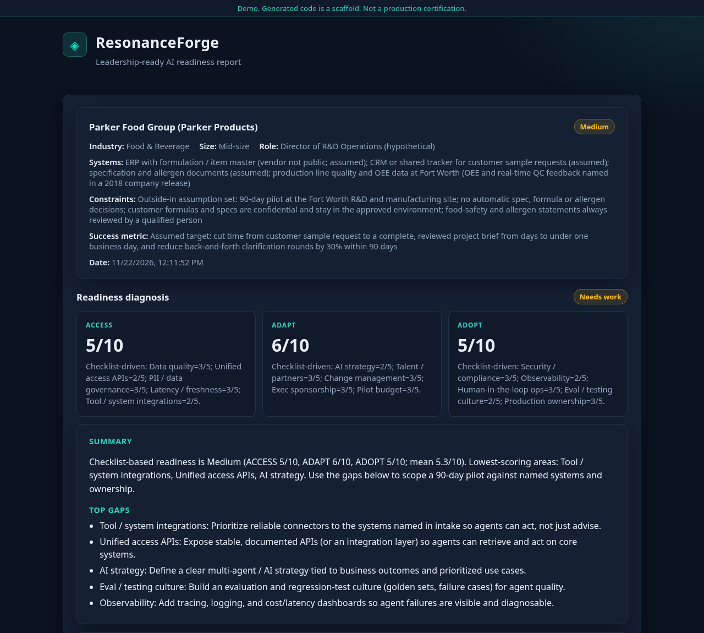
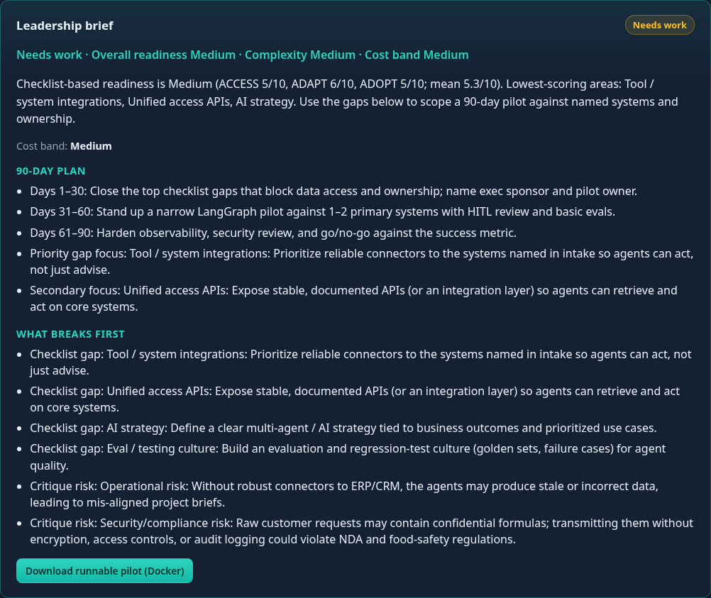

# Parker Food Group — outside-in readiness example

> **Outside-in illustration built only from public information (sources below). Not affiliated with, endorsed by, or reviewed by Parker Food Group. Systems and checklist answers are assumptions, not facts about the company's internal operations. Generated by an LLM pipeline; not a professional assessment.**

Workflow assessed: **Customer sample-request and new-product brief intake (Fort Worth R&D)**. The workflow was picked by the author to fit the company's public footprint. The company did not choose or confirm it.

## Company summary

Parker Food Group (PFG) is a privately held maker of specialty food ingredients (inclusions, toppings, baked pieces, pralines, coatings and bases) headquartered in Fort Worth, Texas. Its brands are Parker Products, founded in 1926, and Creative Food Ingredients. The Fort Worth site is a 90,000+ sq ft manufacturing and R&D plant that opened in 2018 with 12 segregated lines. PFG also has plants in Perry, NY and Mexico, MO. Investindustrial acquired PFG from The Riverside Company in August 2022, when it had about 370 employees. Revenue is not public [1][2][3][4][5].

## Intake summary

- **Role:** Director of R&D Operations (hypothetical)
- **Primary systems:** ERP with formulation / item master (vendor not public; assumed); CRM or shared tracker for customer sample requests (assumed); specification and allergen documents (assumed); production line quality and OEE data at Fort Worth (OEE and real-time QC feedback named in a 2018 company release)
- **Constraints:** Outside-in assumption set: 90-day pilot at the Fort Worth R&D and manufacturing site; no automatic spec, formula or allergen decisions; customer formulas and specs are confidential and stay in the approved environment; food-safety and allergen statements always reviewed by a qualified person
- **Success metric:** Assumed target: cut time from customer sample request to a complete, reviewed project brief from days to under one business day, and reduce back-and-forth clarification rounds by 30% within 90 days
- **Full intake:** [`intake.json`](intake.json) (situation text marks what is sourced and what is assumed)

**Checklist answers (assumptions, 1–5).** These were set conservatively and neutrally because none of this is public. A real assessment would replace every value with answers from the company.

| Question | Assumed answer |
|---|---:|
| Data quality | 3/5 |
| Unified access APIs | 2/5 |
| PII / data governance | 3/5 |
| Latency / freshness | 3/5 |
| Tool / system integrations | 2/5 |
| AI strategy | 2/5 |
| Talent / partners | 3/5 |
| Change management | 3/5 |
| Exec sponsorship | 3/5 |
| Pilot budget | 3/5 |
| Security / compliance | 3/5 |
| Observability | 2/5 |
| Human-in-the-loop ops | 3/5 |
| Eval / testing culture | 2/5 |
| Production ownership | 3/5 |

## Scores across the readiness dimensions

| Readiness dimension | Score | Driver |
|---|---:|---|
| ACCESS | 5/10 | Checklist-driven: Data quality=3/5; Unified access APIs=2/5; PII / data governance=3/5; Latency / freshness=3/5; Tool / system integrations=2/5. |
| ADAPT | 6/10 | Checklist-driven: AI strategy=2/5; Talent / partners=3/5; Change management=3/5; Exec sponsorship=3/5; Pilot budget=3/5. |
| ADOPT | 5/10 | Checklist-driven: Security / compliance=3/5; Observability=2/5; Human-in-the-loop ops=3/5; Eval / testing culture=2/5; Production ownership=3/5. |
| **Overall** | **Medium** | Deterministic checklist rubric (not model-scored) |



## Verdict and top recommendations

Critic verdict: **Needs work**. The 1-pager's go/no-go is **Needs work**. Estimated complexity: **Medium**. Cost band: **Medium**.

Top recommendations, quoted from the run:

> - Develop a thin integration layer (API gateway or service façade) that abstracts ERP, CRM, and knowledge‑base calls, with proper authentication (OAuth2/MUTUAL TLS) and error handling; provide mock implementations for the pilot.
> - Enhance validation logic: load a configurable schema (e.g., JSON Schema) for required fields, incorporate allergen rule tables, and use a rule engine to evaluate claim consistency against regulatory databases.
> - Implement secure data handling: encrypt data at rest and in transit, enforce role‑based access controls, and log all access for auditability.
> - Replace the static analog list with a real retrieval service (e.g., Elasticsearch or a vector store) and include relevance scoring based on key attributes (application, temperature, allergen).
> - Add observability: instrument each node with OpenTelemetry traces, metrics for latency and error rates, and push logs to a centralized SIEM or monitoring dashboard.

Risks the critic flagged, quoted:

> - Operational risk: Without robust connectors to ERP/CRM, the agents may produce stale or incorrect data, leading to mis‑aligned project briefs.
> - Security/compliance risk: Raw customer requests may contain confidential formulas; transmitting them without encryption, access controls, or audit logging could violate NDA and food‑safety regulations.
> - Data quality risk: Naïve parsing of free‑form email text can mis‑interpret fields, causing downstream validation failures and rework.
> - Change‑management risk: Sales and R&D staff may resist a new automated intake if the system frequently generates false‑positive flags or requires extra steps.
> - Scalability risk: The prototype does not address rate‑limiting, concurrency, or handling of multiple simultaneous requests, which could bottleneck during peak periods.
> - Regulatory risk: Allergen and claim checks are not tied to any certified rule engine; missing a flag could result in non‑compliant product releases.

Proposed agents: Ingestion Agent, Validation Agent, Knowledge Retrieval Agent, Drafting Agent, Review Routing & Notification Agent.

## 90-day plan (from the 1-pager)

- Days 1–30: Close the top checklist gaps that block data access and ownership; name exec sponsor and pilot owner.
- Days 31–60: Stand up a narrow LangGraph pilot against 1–2 primary systems with HITL review and basic evals.
- Days 61–90: Harden observability, security review, and go/no-go against the success metric.
- Priority gap focus: Tool / system integrations: Prioritize reliable connectors to the systems named in intake so agents can act, not just advise.
- Secondary focus: Unified access APIs: Expose stable, documented APIs (or an integration layer) so agents can retrieve and act on core systems.

## What breaks first (from the pilot package)

- Checklist gap: Tool / system integrations: Prioritize reliable connectors to the systems named in intake so agents can act, not just advise.
- Checklist gap: Unified access APIs: Expose stable, documented APIs (or an integration layer) so agents can retrieve and act on core systems.
- Checklist gap: AI strategy: Define a clear multi-agent / AI strategy tied to business outcomes and prioritized use cases.
- Checklist gap: Eval / testing culture: Build an evaluation and regression-test culture (golden sets, failure cases) for agent quality.
- Critique risk: Operational risk: Without robust connectors to ERP/CRM, the agents may produce stale or incorrect data, leading to mis‑aligned project briefs.
- Critique risk: Security/compliance risk: Raw customer requests may contain confidential formulas; transmitting them without encryption, access controls, or audit logging could violate NDA and food‑safety regulations.
- Critique risk: Data quality risk: Naïve parsing of free‑form email text can mis‑interpret fields, causing downstream validation failures and rework.
- Weakness: Assumes existence of stable REST APIs for ERP line‑capability, CRM updates, and knowledge base – no concrete integration plan or mock adapters are provided.



## Compile check

Generated LangGraph scaffold: **PASS**. It has 123 lines, `StateGraph` present: True, `.compile()` present: True. This is a static parse and compile check. The code was not executed, and passing means it parses, not that it works.

## Run details

- Assessment id: `f493d746-c165-4ab3-88ce-5f3cec657f22` (local run, 2026-11-22; share links point to a local instance and are not public)
- Model: `openai/gpt-oss-120b` via Groq, temperature 0.2
- Agent latency (ms): diagnostician 0 (rubric only, no model call), architect 1949, code generator 4443, critic 22358 (includes waiting out the provider rate limit)
- LLM output varies between runs. Scores come from the checklist rubric and are reproducible. Verdict, recommendations and code wording may differ.

## How to reproduce

```bash
curl -N -X POST http://127.0.0.1:8000/api/assessments/stream \
  -H "Content-Type: application/json" \
  -H "X-Demo-Token: $DEMO_TOKEN" \
  --data @docs/examples/parker-food-group/intake.json
```

## Sources

1. https://www.parkerfoodgroup.com/aboutus — brands, capabilities, facility list (Fort Worth, Perry NY, Mexico MO)
2. https://parkerproducts.com/parker-products-increases-capacity-efficiency-new-fort-worth-plant/ — 2018 Fort Worth plant release (90,000 sq ft, digital QC and OEE feedback from lines)
3. https://www.businesswire.com/news/home/20220810005799/en/Investindustrial-Acquires-Parker-Food-Group-a-Leading-Developer-of-Value-Added-Ingredients-in-North-America — 2022 acquisition release (~370 employees, 150+ customer touch points per project, Fort Worth HQ)
4. https://www.riversidecompany.com/currents/parker-food-group-exit-news-release — Riverside exit release (>$30M Fort Worth greenfield plant)
5. https://www.reuters.com/business/retail-consumer/italys-investindustrial-buys-us-toppings-maker-parker-food-2022-08-11/ — Reuters coverage of the acquisition
