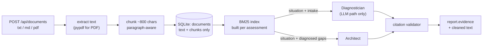

# Grounding in customer documents (RAG)

Optional. If you upload nothing, an assessment runs exactly as before.

The checklist tells ResonanceForge how ready a team says it is. Documents such as an
SOP or an IT systems note show how the workflow actually runs. With documents
attached, the Architect (and the Diagnostician when it has to estimate) gets the
most relevant passages in its prompt. It cites them inline as `[D1:C2]`, meaning
document 1, chunk 2. The report then lists every passage in an **Evidence** section.

## Flow

1. **Upload.** `POST /api/documents` takes multipart `files`. It needs the demo
   token, has its own per-IP limit (`UPLOAD_RATE_LIMIT_PER_HOUR`, default 20), and
   returns a `document_set_id`. Labels `D1`, `D2`, … follow upload order.
2. **Assess.** Send `document_set_id` in the body of `POST /api/assessments/stream`
   or `POST /assess`. An unknown id returns **422** before any LLM call. The id is
   stored on the assessment row.
3. **Retrieve.** The app builds a BM25 index over that set's chunks and takes the
   top `RAG_TOP_K` (default 4) for each agent:
   - Diagnostician: queried with the situation and intake fields. This only happens
     when the 15-question checklist is incomplete. With a complete checklist, scores
     come from the rubric and documents never change them.
   - Architect: queried with the situation plus the diagnosed top gaps, so the
     passages match what the design has to fix.
4. **Validate citations.** After the Architect returns, every `[D<n>:C<m>]` marker
   in the diagnosis and architecture text is checked against the passages *that
   agent was shown*. Unknown or out-of-scope markers are removed, and
   `evidence.citations_dropped` counts them. The Code Generator, the Critic, the UI,
   and the share page only ever see the cleaned text.
5. **Report.** `report.evidence` lists each retrieved passage with its document,
   chunk number, BM25 score, which agent saw it, and whether it was cited. The UI,
   the share page `/r/{id}`, and the Markdown export all render it.

## Limits

| Setting | Default | On violation |
|---------|---------|--------------|
| `RAG_MAX_FILES` | 5 per upload | 413 |
| `RAG_MAX_FILE_BYTES` | 2,000,000 per file | 413 (the server reads at most limit + 1 bytes) |
| `RAG_MAX_TOTAL_CHARS` | 300,000 extracted characters per set | 413 |
| Types | `.txt`, `.md`, `.markdown`, `.pdf` | 415 |
| Empty, binary-looking, encrypted, or malformed PDF | | 422 |

Filenames are reduced to a safe basename and never used as a filesystem path. Only
the extracted text and chunks are stored. The raw upload bytes are not written to
disk.

## Why BM25 and not embeddings

- No model download, no GPU, no extra service. It adds `pypdf` and
  `python-multipart` (both pure Python), so the Docker image stays small.
- SOPs and system notes use the same words as the intake ("ERP", "work order",
  "priority"), so lexical matching works well for this kind of document.
- It is deterministic, which keeps the evals in CI stable.

The trade-off is that BM25 misses synonyms ("RMA" vs "return"). `Retriever` in
`app/rag/retrieval.py` is the swap point. A dense index, for example Bedrock Titan
embeddings with pgvector, would replace it without touching the agents or the
validator.

## Try it

Two fictional documents for the Red River demo case are in
[`docs/sample-docs/`](sample-docs/README.md), along with the curl commands.

In one local run with those two documents (Groq `openai/gpt-oss-120b`, complete
checklist), the Architect cited 3 of the 4 retrieved passages and the validator
dropped 0 citations. For example: "By keeping all processing on-prem (or within the
approved cloud tenant) we satisfy the data-location constraint [D2:C2]." That is a
single run, not a benchmark. Model output varies between runs.

## Not done yet

- The public share page `/r/{id}` shows the Evidence passages, the same way it shows
  the rest of the report. Do not attach documents you would not share with the link.
- No per-tenant isolation. Anyone with the demo token and a `document_set_id` can
  attach that set. Sets are not deleted automatically.
- No OCR. Scanned PDFs without a text layer return 422 ("no extractable text").
- The Code Generator and Critic do not get passages directly. They see the
  Architect's cleaned, cited output.
- Retrieval quality is not scored yet beyond the citation-validity checks.
